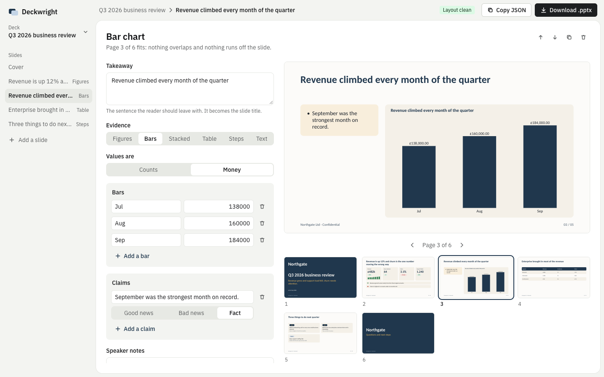

# Deckwright (pptx-report-engine)

Describe a deck as plain JSON, get a designed, layout-checked PowerPoint file. No design work, no templates.



## The editor

```
npm install
npm run dev        # http://localhost:5173
npm run build      # static site in dist-app/
```

Write each slide as a takeaway plus one kind of evidence (figures, bars, stacked bars, a table, next steps or text). The preview is drawn from the engine's own drawing calls, so what you see is the layout that goes into the file, and the top bar says whether anything overlaps or runs off a slide. **Download .pptx** builds the file in your browser; nothing is uploaded. **Copy JSON** and **Edit as JSON** move a deck in and out. The deck is kept in your browser's local storage.

## The engine

```ts
import { buildDeckFromSpec } from './src'

const bytes = await buildDeckFromSpec(
  {
    title: 'Q3 2026 business review',
    subtitle: 'Revenue grew and support load fell; churn needs attention.',
    period: 'Jul to Sep 2026',
    footer: 'Northgate Ltd · Confidential',
    slides: [
      {
        title: 'Revenue is up 12% and churn is the one number moving the wrong way',
        kpis: [
          { label: 'Revenue', value: '£482k', change: '+12%', trend: [31, 34, 38, 44, 47] },
          { label: 'Churn', value: '3.1%', change: '+0.6 pts', better: 'down' },
        ],
        bullets: ['Growth came mostly from the three largest accounts.'],
      },
    ],
  },
  { brand: 'Northgate', logoWhite, logoBlue }, // logos are optional PNG data URLs
)
```

`npm run sample` writes `out/quarterly.pptx` from `examples/quarterly.json`. `npm run sample -- my-deck.json` builds your own spec.

A slide's `title` is its takeaway, written as the sentence you want the reader to leave with. Give each slide one kind of evidence: `kpis`, `chart`, `stacked`, `table` or `actions`; `bullets` add plain-language claims, tinted by `tones`. Types are in `src/spec.ts`.

## Layers

| File | Job |
| --- | --- |
| `src/spec.ts` | `DeckSpec` (simple JSON) to frames. |
| `src/frames.ts` | `SlideFrame`: the neutral description of one slide. Build these yourself for full control. |
| `src/pptx.ts` | The drawing engine: frames to `.pptx` with PptxGenJS. Fixed grid, tonal cards (no lines or shadows), one corner radius, measured and clipped text, charts, sparklines, merged chart + detail slides, speaker notes. |
| `src/adapters/report/` | An example adapter: a full operations-report model (sections, spend, step performance, models used, recommendations) turned into frames. Copy it to feed your own data model in. |
| `src/theme.ts`, `src/format.ts` | Palette and currency symbol. Edit to re-skin. |

`repairPptxPackage()` fixes the package PptxGenJS 4.0.1 writes (phantom `[Content_Types].xml` overrides, notes master sharing the slide master's theme, unused default extensions; gitbrent/PptxGenJS#1449) so strict readers open it. `xmlSafe()` strips characters that are illegal in XML.

## Design tools

- **Live preview**: `{ trace }` returns every drawing call per slide; `app/Preview.tsx` redraws them, which is how the editor shows the real layout.
- **Layout check**: `checkLayout(boxes)` turns the inspector's boxes into plain problems (`runs off the slide`, `meets`).
- **Layout inspector**: `{ inspect }` returns every box placed on every slide. Tests assert nothing overlaps, leaves the slide or enters the footer band.
- **Package tests**: zip integrity, well-formed XML, every relationship target exists, hostile text, finite chart values, idempotent repair.
- **Crowded fixture**: every optional part present with text well past what fits.
- **Render to look at**: `RENDER_DECK_DIR=out npx vitest run src/pptx-layout.test.ts`.
- **Second reader**: `npm run check:office` converts with LibreOffice (`soffice` on PATH) and expects one PDF page per slide.

Fonts are Calibri because custom fonts cannot be embedded in a pptx.
